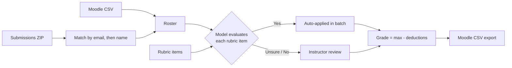

# AI Grading Tool

Grade intro-CS Python assignments in a fraction of the time. Import the Moodle roster and a ZIP of submissions, let an LLM check every submission against your rubric, review its verdicts, and export grades and feedback back to Moodle.

Built at Calvin University for grading intro-CS Python labs.

## What it does

| Step | What happens |
|---|---|
| **Import** | Load the Moodle gradebook CSV, then a ZIP of submissions (Canvas/Moodle nested ZIPs, ZyBooks folders, or plain `.py` files). Submissions are matched to students by email, with a name fallback for compound last names. |
| **Evaluate** | For each student, the model answers **Yes / No / Unsure** for every rubric item. Nothing is applied until you confirm. In batch mode, only clear **Yes** verdicts are auto-applied, and everything uncertain waits for review. |
| **Discover** | The model reads all submissions and proposes new rubric items for mistakes that keep coming up. You promote the ones worth keeping. |
| **Exercise check** | Paste the assignment text, and the model extracts the requirements and marks each one as met, partial or not met, with a suggested deduction. |
| **Turtle graphics** | The student's turtle program runs in the browser through Pyodide, and a vision model compares the drawing with the code. |
| **ZyBooks labs** | Multi-part ZyBooks labs are graded part by part (auto-graded parts come straight from the ZyBooks CSV) and combined into one weighted Moodle grade. |
| **Export** | Grades and feedback go back out as a Moodle-ready CSV. Progress autosaves to a local JSON file. |



## Design choices

- **The instructor stays in charge.** The model never assigns a grade directly. It answers narrow yes/no questions about rubric items the instructor wrote, and the grade is computed from those.
- **No backend.** Everything runs in the browser. Each instructor pastes their own OpenAI key in *AI Feedback Settings*; it is kept in that browser's `localStorage` and sent only to OpenAI, so a deployed build never contains a key.
- **Batches can be stopped.** Long batch runs report progress and can be cancelled mid-way without losing finished students.
- **The model is configurable.** The default is `gpt-5-mini`, and you can switch to any chat model that returns JSON (and accepts images, for the turtle panel).

> Student code is sent to OpenAI for evaluation. Check your institution's policy on sharing student work with third-party services before using real submissions.

## Getting started

Requires Node.js 20 or newer.

```bash
npm install
npm run dev
```

Open http://localhost:3000, add your OpenAI API key under **AI Feedback Settings**, then import a Moodle CSV and a submissions ZIP.

For local development only, you can put `VITE_OPENAI_API_KEY=sk-...` in a `.env` file instead of typing the key in. The dev server reads it, and production builds ignore it.

| Command | What it does |
|---|---|
| `npm run dev` | Start the dev server on port 3000 |
| `npm run build` | Type-check and build to `dist/` |
| `npm run lint` | Run ESLint |
| `npm run deploy` | Build and publish `dist/` to GitHub Pages |

## Tech stack

React 18, TypeScript, Vite, Tailwind CSS, OpenAI SDK, Pyodide (in-browser Python), PapaParse, JSZip, dnd-kit, react-syntax-highlighter.

## Project layout

```
src/
  App.tsx                    app state, AI workflows, ZyBooks session
  lib/llm.ts                 prompts and OpenAI calls (rubric, exercise, vision)
  lib/aiConfig.ts            API key and model settings (browser-only)
  lib/zipUtils.ts            submission ZIP parsing and student matching
  hooks/                     Moodle CSV, ZIP and ZyBooks CSV import
  components/
    AISettings/              AI modes, key settings, stop control
    FeedbackReviewPanel/     review and confirm Yes/No/Unsure verdicts
    StudentCodePanel/        code viewer with line-level AI comments
    TurtlePanel/             Pyodide runner and vision check
    ZyBooksPanel/            multi-part lab grading
    Feedback/, StudentList/  rubric editor and student roster
moodle-grading-extension/    browser extension that sends Moodle data to the app
```

## Credits

This project grew out of the Moodle Grading App, a Calvin University project advised by **Victor Norman**:

- **Emily Costa** and **Michael Sisko** built the first version ([MoodleGradingApp/Client](https://github.com/MoodleGradingApp/Client)).
- **Haneum Cha** and **Prince Nuertey Padi** rebuilt it in React (this repository's base, 2024-2025). Their version included the Moodle roster import, the rubric editor, grade calculation, change history, autosave, Moodle CSV export and the Moodle browser extension.

**Eduard Dehelean** (2026) turned it into an AI-assisted grader. He added submission import and matching, the code viewer, every AI workflow (rubric evaluation, criteria discovery, exercise checking, turtle-graphics vision), the ZyBooks multi-part lab workflow, the redesigned interface and the bring-your-own-key setup.

## Roadmap

- Per-part weights for ZyBooks labs
- Unit tests for ZIP matching and grade calculation
- Move to React 19, Vite 8 and Tailwind 4
